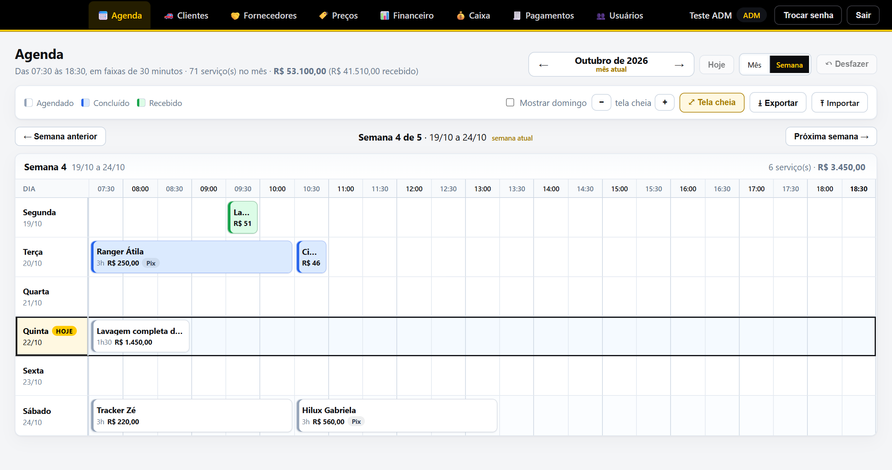
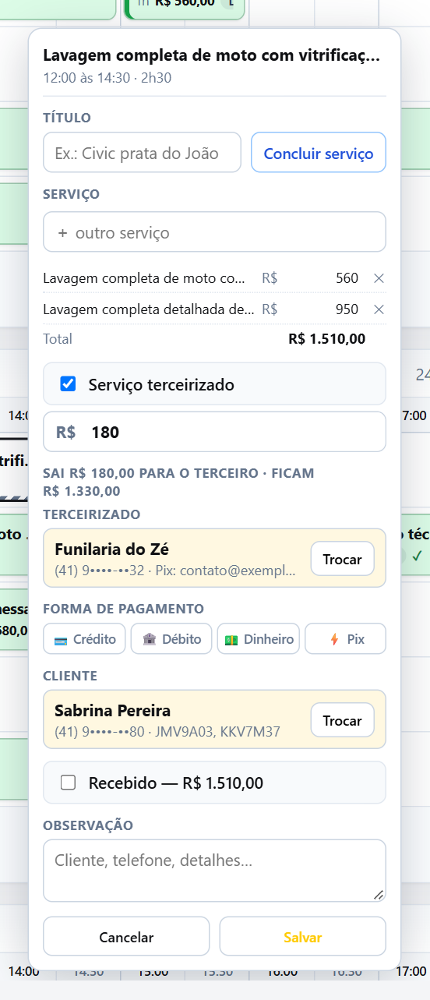
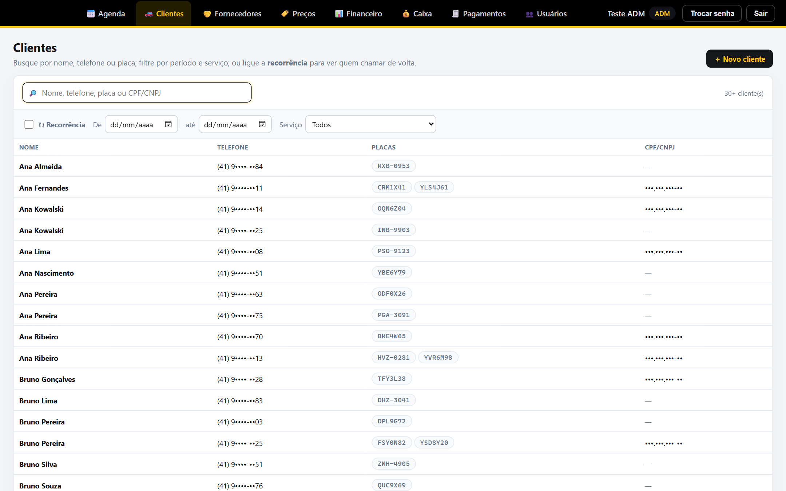
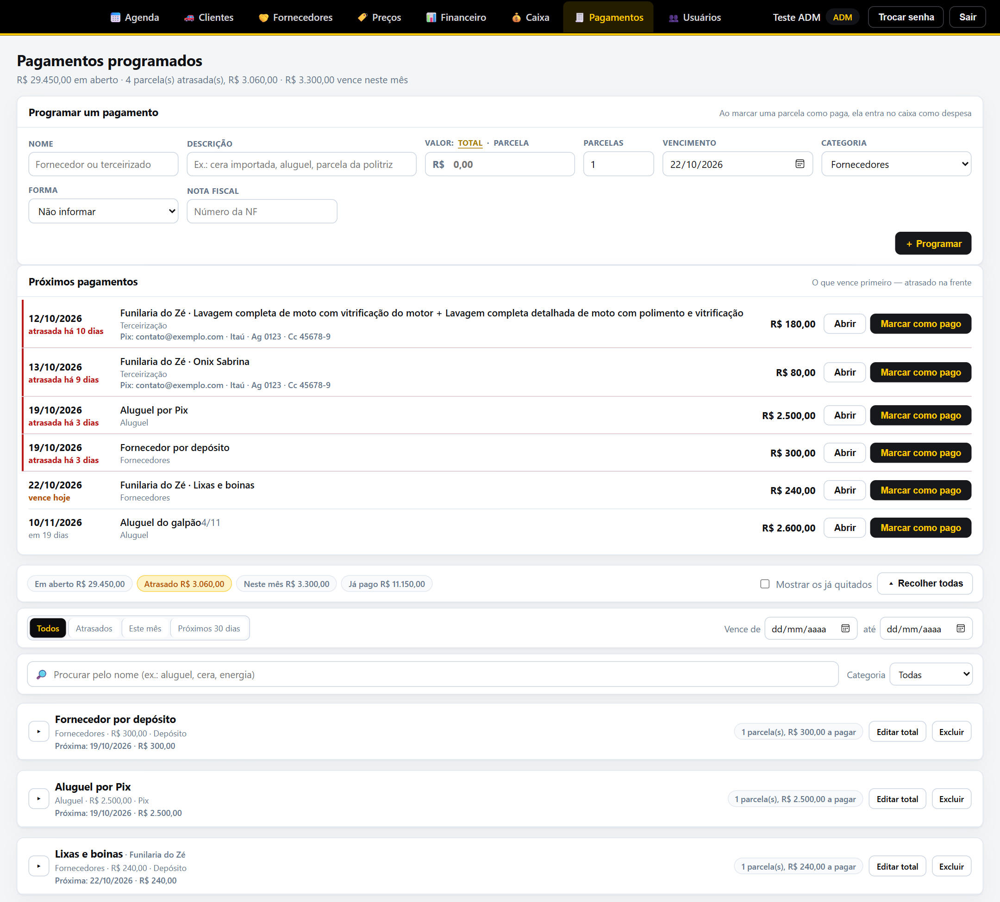
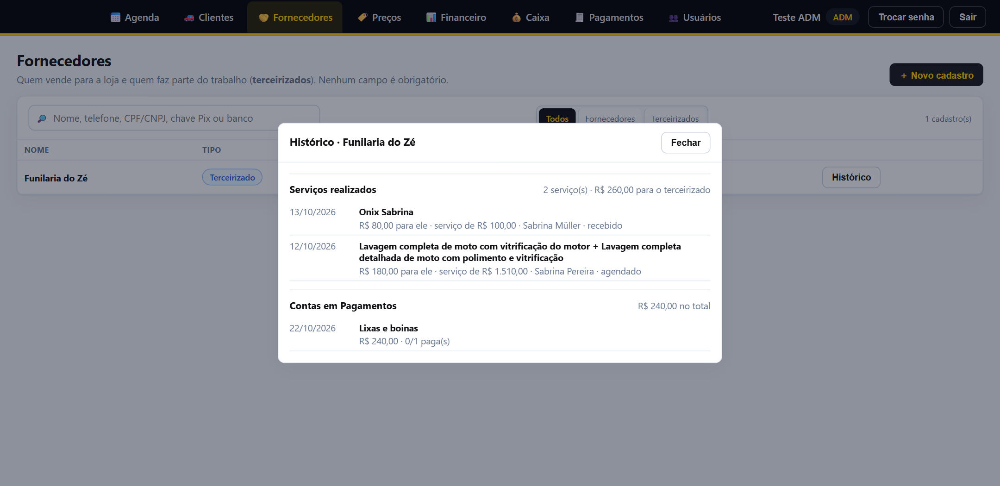
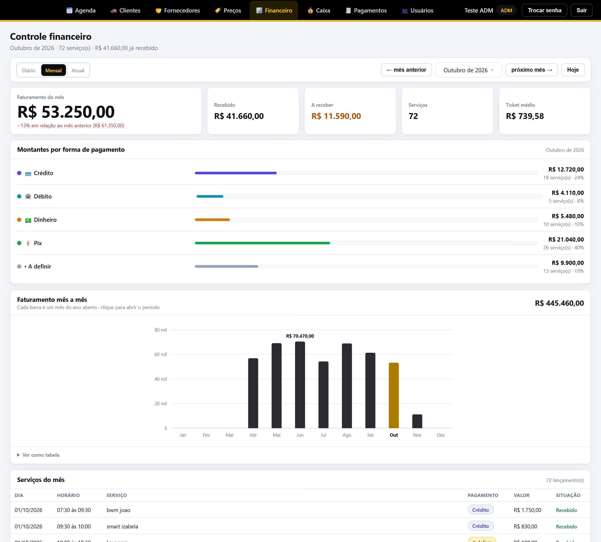
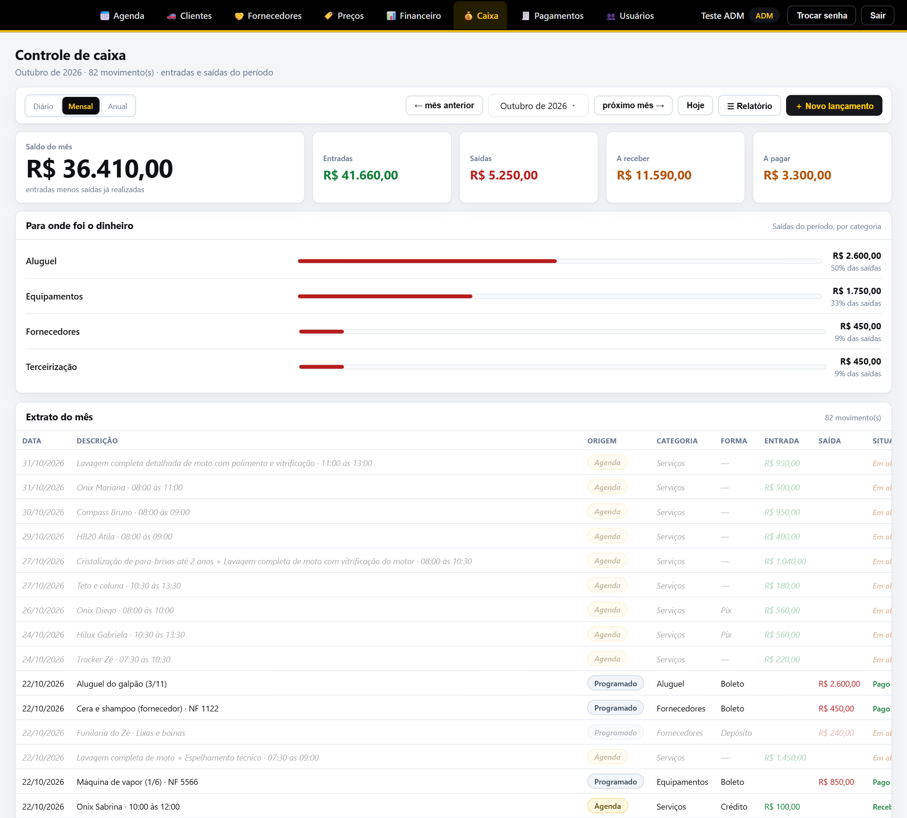
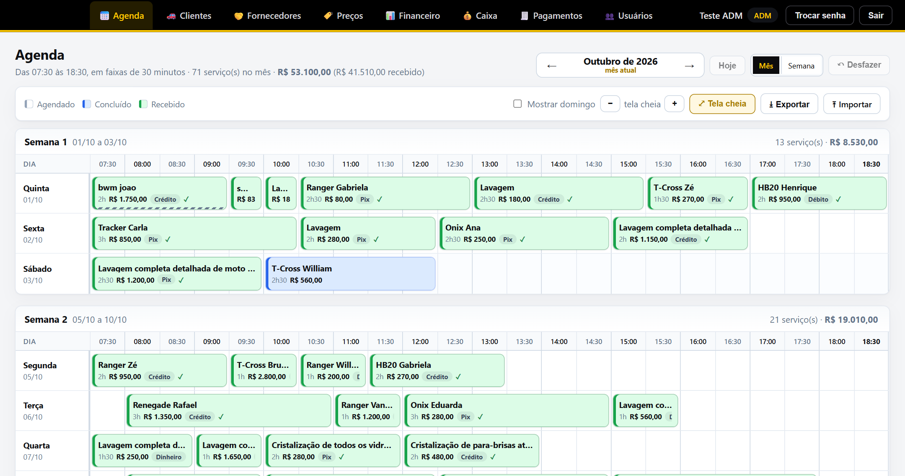
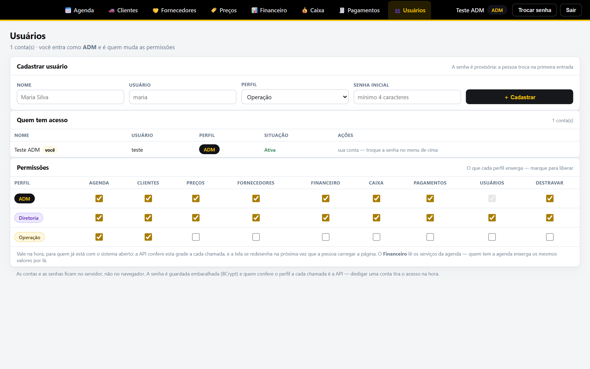

# Agenda para estética automotiva

**Agenda, clientes, fornecedores, financeiro, caixa e contas a pagar para uma estética
automotiva.** Feito sob demanda e preparado para ser vendido como produto, por mensalidade.

Kotlin · Spring Boot 3 · React 18 · TypeScript · H2 / PostgreSQL · Flyway · JWT · Server-Sent Events · Cloudflare Tunnel

> Este repositório é a vitrine do projeto: mostra o que ele faz e como foi construído. O
> código-fonte é fechado, porque o sistema é vendido como produto. Os prints usam dados
> fictícios, com documentos e telefones mascarados.

## Meu papel

Conduzi o projeto de ponta a ponta: levantei com o dono e a equipe como a agenda e o
dinheiro circulavam, defini as regras de negócio (o que é forma de recebimento, como uma
parcela vira despesa, quem enxerga o quê, quando um serviço conta no caixa), e acompanhei a
implantação e o dia a dia depois dela. O desenvolvimento foi feito com IA (Claude Code), com
as regras garantidas por testes automatizados.

## O problema

A agenda da loja era um caderno e uma planilha. O valor de cada serviço, a forma de
pagamento e o que já tinha sido recebido ficavam espalhados, e o fechamento do mês era feito
na mão. As contas a pagar, os clientes e quem fazia o serviço terceirizado ficavam fora de
tudo isso.

## O que o sistema faz

| | |
| :--- | :--- |
| **Agenda do mês ou da semana** | Faixas de 30 minutos (07:30 às 18:30), o mês inteiro ou uma semana por vez. Marca com dois cliques, arrasta para outro horário ou dia, estica pelas bordas, troca dois serviços de lugar soltando um em cima do outro, desfaz com Ctrl+Z. No celular, uma lista do dia com gaveta de edição. |
| **A cor diz em que pé está** | Branco é agendado, azul é concluído (o trabalho terminou) e verde é recebido. Um botão ao lado do título conclui o serviço. |
| **Serviço de vários dias** | Copiar e colar um card em outro dia vira a continuação do mesmo serviço: os cards ficam ligados, mudar um muda todos, e o dinheiro conta uma vez só, no último dia. |
| **Serviços da tabela de preços** | O card puxa os serviços de uma tabela de preços (com variação por porte do carro) e soma o valor sozinho. A tabela tem recorrência em dias, usada para chamar o cliente de volta. |
| **Clientes** | Cadastro com telefone, placas e CPF ou CNPJ (inclusive o CNPJ alfanumérico). Recebido exige cliente e forma de pagamento. Filtros por período, por serviço e por recorrência: quem está na hora de voltar. |
| **Fornecedores e terceirizados** | Cadastro com chaves Pix e contas bancárias. O terceirizado é escolhido no card; a parte dele vira uma parcela em Pagamentos com o nome, o serviço e como pagar. Cada cadastro tem o histórico do que já fez. |
| **Todos veem a mesma agenda, ao vivo** | Quando alguém marca ou move um serviço, as outras telas se atualizam sozinhas, sem F5. |
| **Controle financeiro** | Faturamento do dia, do mês ou do ano, com a variação contra o período anterior, recebido, a receber, ticket médio, montantes por forma de pagamento e gráfico clicável. |
| **Caixa** | Junta três fontes num extrato só: os serviços da agenda (no dia em que foram recebidos), as parcelas pagas e os lançamentos avulsos. Nada é digitado duas vezes. |
| **Pagamentos programados** | Contas parceladas com nota fiscal, nome de quem recebe (puxado do cadastro, com a chave Pix ou a conta), depósito e Pix, editar o total, excluir uma parcela, alerta de atrasadas e "Marcar como pago" que joga a despesa direto no caixa. |
| **Permissões configuráveis** | Três perfis (ADM, Diretoria, Operação). O ADM liga e desliga o acesso de cada perfil a cada parte do sistema numa grade, e vale na hora. |

| O serviço aberto | Clientes |
| :---: | :---: |
|  |  |

| Pagamentos programados | Histórico de um terceirizado |
| :---: | :---: |
|  |  |

| Financeiro | Caixa |
| :---: | :---: |
|  |  |

| A agenda do mês | Permissões por perfil |
| :---: | :---: |
|  |  |

## Decisões técnicas

- **Quem barra é a API, não a tela.** Cada rota pertence a uma área, e a API consulta a grade
  de permissões a cada chamada. Tirou a permissão, a próxima requisição responde `403`, mesmo
  para quem já estava com o sistema aberto.
- **Tempo real que atravessa o túnel.** As telas escutam o servidor por *Server-Sent Events*.
  O aviso não carrega dado, só "a agenda mudou", e cada tela busca de novo pela autenticação
  de sempre. A atualização espera o usuário terminar o gesto (arrastar, digitar, menu aberto)
  e as gravações em andamento. Uma batida a cada 25 s mantém a conexão viva atrás da Cloudflare.
- **Dois marcando ao mesmo tempo.** O servidor recusa um serviço que caia em cima de outro e
  diz quem já está lá. A troca de lugar entre dois cards vai num pedido só, tudo ou nada.
- **O dinheiro conta uma vez.** Num serviço de vários dias, só o card do último dia entra no
  caixa, no financeiro e no total da semana; o recebido entra no caixa na data em que foi
  recebido, não na data do agendamento. As duas regras valem igual na tela e no servidor.
- **Só o que a tela mostra viaja.** Cada tela pede só o pedaço de que precisa. Com 10 anos de
  agenda cheia (35 mil serviços), a agenda do mês caiu de 5,8 MB e 2,8 s para **51 KB e 90 ms**.
- **Pronto para rodar sozinho no cliente.** Backup automático diário com cópia para o Google
  Drive, cópia antes de cada migração do banco, volta à versão anterior sem perder dados,
  limite de tentativas de senha, chave JWT gerada por instalação e validação de cada campo
  antes de o banco reclamar: nenhuma entrada vira erro 500.
- **Otimista na agenda, conservador no caixa.** Na agenda, a mudança aparece na hora e vai
  para o servidor em seguida, numa fila por item. No caixa, cada ação espera a resposta,
  porque dinheiro não pode aparecer na tela antes de estar gravado.

## Como roda

Roda num servidor Windows da empresa, como serviço, e é publicado na internet por um
Cloudflare Tunnel: HTTPS, nenhuma porta aberta no roteador. Tela, API e banco saem de um
único `.jar`. A atualização é um pacote com o `.jar` novo e dois atalhos (parar e ligar); o
banco se ajusta sozinho na primeira partida.

## Qualidade

- **147 testes no backend** (JUnit 5, sobre a aplicação inteira): primeiro acesso, a grade de
  permissões rota por rota, conflito de horário, parcelamento, serviço de vários dias,
  terceirização, clientes, fornecedores e recebimento.
- **167 testes no frontend** (Vitest): as contas da grade, do financeiro, do caixa, do
  rascunho do card e dos serviços de vários dias.
- Migração testada sobre uma cópia do banco de produção, volta à versão anterior conferida,
  bateria de carga com 10 anos de dados gerados e sondagem de entradas inválidas antes de
  cada versão.
- O pacote de produção não é gerado se algum teste falhar.

---

Feito por [Wender de Oliveira](https://github.com/wender95).
